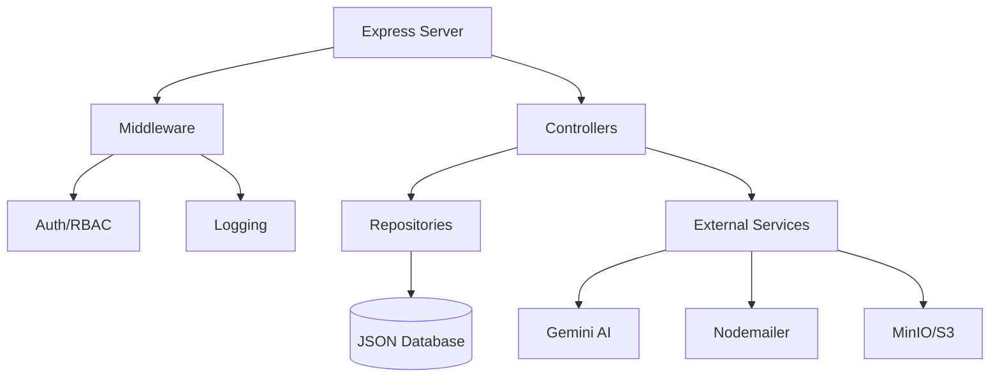
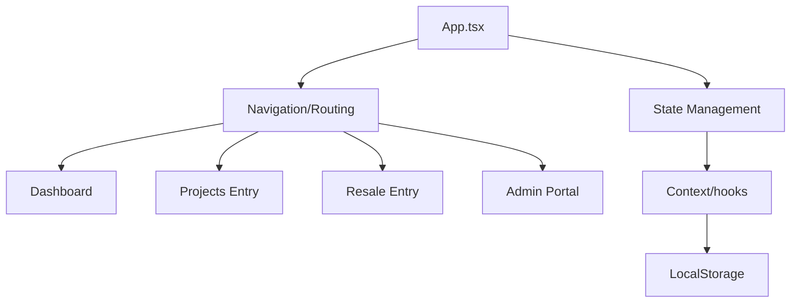
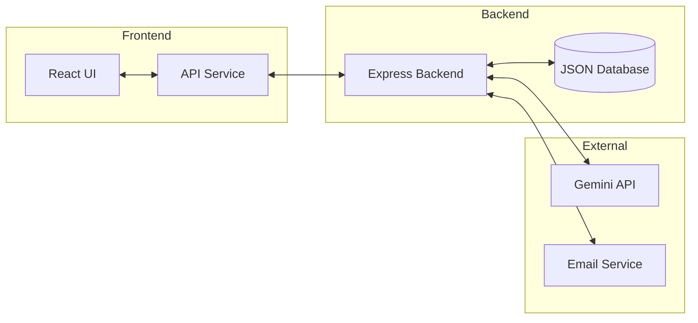

# Application Architecture

This document provides a high-level overview of the pySync CRM architecture.

## 1. Backend Architecture
The backend is built with **Node.js** and **Express**, utilizing a file-based JSON database for persistence.

## 2. Frontend (UI) Architecture
The frontend is a **React** Single Page Application powered by **Vite** and **Tailwind CSS**.

## 3. Full-Stack Data Flow
Interaction between the UI, Backend, and Database.

